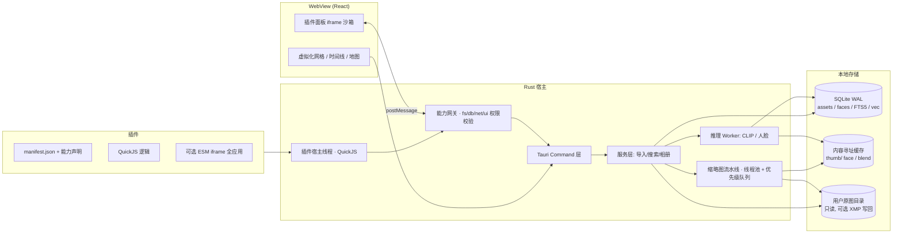
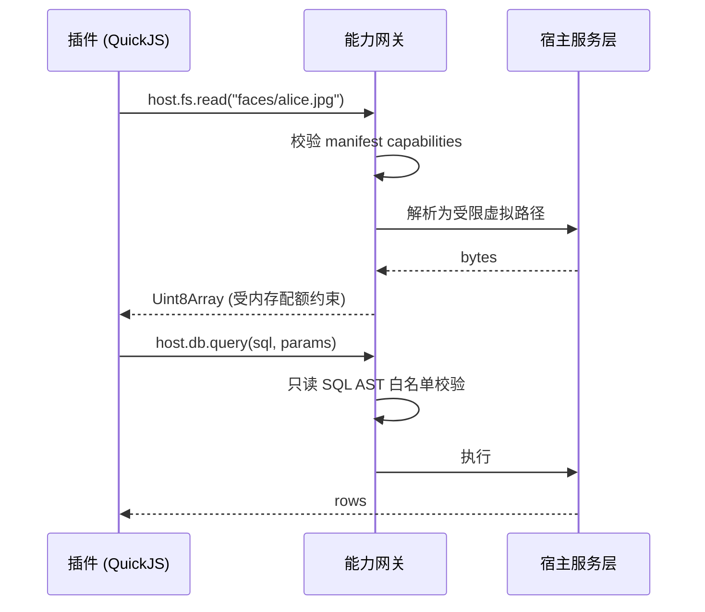

# Lumenfold 架构

> 配套文档：[开发计划](./ROADMAP.md) · [ADR](./adr/)

---

## 1. 总体分层



### 关键决策：缩略图不走 IPC

缩略图通过 Tauri 自定义协议 `http://lumen.localhost/thumb/<hash>` 提供，**不逐张走 Tauri Command**。这样浏览器自身的图片缓存、解码、内存回收、并发请求调度全部生效。

虚拟滚动不掉帧靠的是这一条，而不是靠优化 Rust。

## 2. 仓库结构

```
lumenfold/
├─ apps/desktop/                Tauri 壳 + 前端
│  ├─ src/                      React（gallery/ timeline/ map/ people/ search/ plugins-ui）
│  └─ src-tauri/
│     ├─ crates/
│     │  ├─ lumenfold-core/     领域模型、错误类型、事件定义（被所有 crate 依赖）
│     │  ├─ lumenfold-index/    SQLite schema、迁移、查询、FTS5、sqlite-vec
│     │  ├─ lumenfold-imaging/  libvips 封装、RAW/HEIC、色彩管理、pHash、感知嵌入
│     │  ├─ lumenfold-pipeline/ 扫描、EXIF 抽取、缩略图队列、文件监听
│     │  ├─ lumenfold-ai/       模型注册表、下载器、ONNX 推理、CLIP / 人脸
│     │  ├─ lumenfold-faces/    检测、嵌入、聚类（union-find + 增量重聚）
│     │  └─ lumenfold-plugin/   QuickJS 运行时、生命周期、能力网关、看门狗
│     └─ bin/lumenfold-cli/     headless 索引/校验/迁移工具（CI 与排障用）
├─ sdk/
│  ├─ types/                    TS 类型 + 协议（唯一公开 API 面）
│  └─ plugin-template/          pnpm create-lumenfold-plugin
├─ native-deps/                 预编译 libvips/libheif/libraw（win/mac/linux × 双架构）
└─ docs/                        rfcs/ adrs/ 插件开发指南
```

## 3. 数据模型

| 表 | 关键字段 | 备注 |
|---|---|---|
| `assets` | path, dir_id, size, mtime, hash_fast, mime, w, h, orient, rating, taken_at, thumb_state, deleted_at | `hash_fast` = 首尾各 1MB + size + mtime（BLAKE3），用于秒级增量去重 |
| `metadata` | camera, lens, iso, shutter, aperture, focal, tz_offset, gps_lat/lon, keywords_json, caption, copyright | 独立表，行式查询友好 |
| `embeddings` | asset_id, model, vec | sqlite-vec HNSW；int8 量化后 10 万张约 50MB |
| `faces` / `people` | bbox, score, embedding / name, cover | 聚类用 union-find 增量合并 |
| `albums` / `smart_albums` | 手工 / `query_json` 保存的查询 | |
| `jobs` | kind, priority, state, progress | **持久化**，索引任务跨重启续跑 |
| `plugins` | version, granted_caps_json, state, crash_count | |

**迁移策略**：版本化 + 向下迁移脚本；每次迁移前自动备份 `assets.db`；定期 `integrity_check`，损坏时自动回滚到最近备份。

## 4. 插件体系

插件是本项目的核心资产。分四层，缺一层就没法写插件。

| 层 | 契约 | 说明 |
|---|---|---|
| **清单** | `lumenfold.json` | id / apiVersion / entry / `capabilities`（fs 路径、db 读写、net 域名白名单）/ 触发器 |
| **逻辑** | QuickJS | `host.db.query`、`host.photos.get`、`host.tasks.register`、`host.log` |
| **UI-轻量** | DOM + 绑定 | 无需构建，声明式渲染侧栏面板 / 右键菜单项 / 筛选器 |
| **UI-完整** | sandboxed iframe | 插件自带 ESM 产物，可打包 React，与宿主版本解耦 |

### 沙箱策略



- 每个插件一个 QuickJS context，跑在**独立的插件宿主线程池**，不占 UI 线程；
- 三重硬限制：`set_memory_limit` + 栈深上限 + interrupt handler 超时。看门狗发现无响应直接销毁 context 并标记插件崩溃，宿主不受影响；
- 能力在**网关层强制**，不在插件层自觉——`fs` 只能通过虚拟路径访问被授权子树；`net` 默认关闭，只能访问 manifest 声明的域名；SQL 走只读 AST 白名单而非字符串拼接；
- 网络/文件能力在安装时由用户显式授权，可在设置中随时吊销；
- **API 只定义一次**：默认 QuickJS 进程内执行，为不信任插件预留"严格模式"（同一份产物跑在 Deno 子进程）。协议不变 → 生态不被实现细节绑架。

### 插件版本策略

`sdk` 独立发版、semver、公开 API 带 `@since` 标注。破坏性变更必须走 RFC 流程，并提供至少两个小版本的迁移垫片。

**生态信任来自这条规则，不来自代码质量。**

## 5. 数据流水线

```
文件监听 / 初始扫描
  → hash_fast 去重 → assets 落库
  → 元数据抽取（EXIF/IPTC/XMP）
  → 优先级缩略图队列（可见区优先，其余按新近度）
  → AI Worker（CLIP 标签 / 人脸检测嵌入）
  → sqlite-vec 索引 / faces 聚类
```

- **队列优先级**：视口内 > 缩略图网格已请求 > 最近新增 > 剩余。
- **缓存**：内容寻址（`<appdata>/cache/<hash[0:2]>/<hash>/<size>.webp`），LRU 上限默认 10GB，可配，一键重建。
- **取消**：文件在队列中时删除或改动 → 任务取消，不产生脏缩略图。